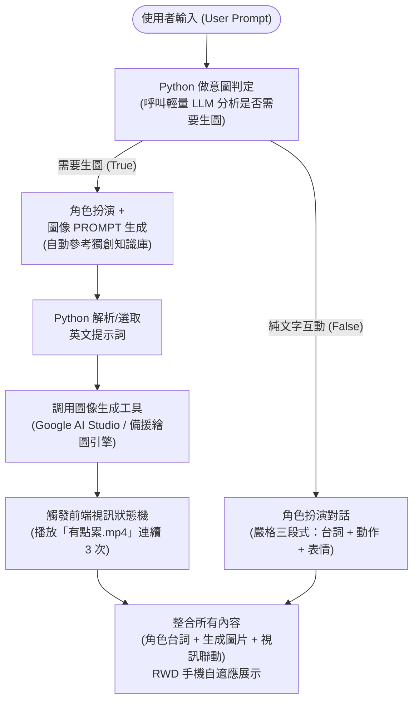

# AI Agent 架構設計：角色扮演 + 功能性生圖 (RWD 優化版)

> 本文件依據 `AI助教課1117-AI Agent架構.pdf` 之流程圖與課堂教學脈絡建立。

---

## 核心設計理念

結合第八週 AI Agent 架構設計之核心三要素：
- **角色扮演 (Role-Playing)**：賦予性格、語氣、招牌動作與情緒反應（地雷系哥特風可愛少年「晴琉」）。
- **領域知識 (Domain Knowledge)**：整合日系地雷系（Jirai Kei）與哥特龐克次文化美學符號。
- **工具調用 (Tool Use)**：串接 Google AI Studio / Groq API，自動判定意圖並調用生圖工具。

---

## 系統整體架構流程圖

---

## 流程步驟詳解

1. **使用者輸入**：
   - 使用者透過 RWD 手機版或電腦版網頁發送文字訊息。
2. **Python 意圖判定 (Intent Classification)**：
   - 調用輕量敏捷模型（如 Gemini 2.5 Flash / Gemini 3.8 / Groq Llama 3.1 8B），輸出標準 JSON：`{"need_image": true/false}`。
3. **分支執行管線**：
   - **生圖分支**：
     - 晴琉以可愛呆萌口吻回應用戶，並在 `<image_prompt>` 標籤中生成高品質英文生圖提示詞。
     - Python 後端使用正則表達式抽取提示詞並調用生圖 API。
     - 前端捕獲信號後，將視訊從待機切換至「有點累.mp4」，精準循環播放 3 次。
   - **純文字分支**：
     - 保持黏人、傲嬌與天然呆人設，輸出三段式對話（台詞 + 動作 + 表情顏文字），不觸發生圖。
4. **前端 RWD 響應式渲染**：
   - 自動適配手機直屏與電腦寬屏，流暢呈現角色視訊、對話氣泡與生成的圖像卡片。

